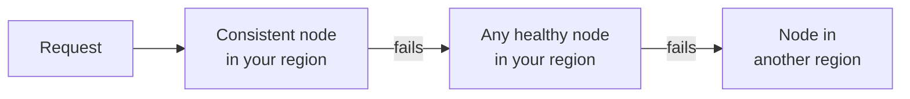

A request doesn't depend on one node. If the node it's sent to can't answer, it moves to the next one, and if a whole region has a problem, traffic moves to another region. You don't need to retry or change anything.

## Within a request

Each request tries nodes in this order, and moves on if one times out or can't answer, such as when it doesn't have the block yet:

1. **A consistent node in your region.** A node that's caught up with the latest block we've served you, so [reads stay consistent](/docs/documentation/architecture/engine/consistency/read-consistency).
2. **Any healthy node in your region.** If no consistent node can answer, another node in the same region takes the request.
3. **A node in another region.** If no node in your region can answer, the request goes to another [region](/docs/documentation/architecture/regions) that runs the network. It takes a little longer, but you still get an answer.

## Across a region

We move all of a network's traffic out of a region in two cases:

* **Every node for the network in the region is down.**
* **The network stalls in the region.** If the latest block in the region stops moving, we treat the region as unhealthy and send traffic elsewhere until it recovers. We check this on networks with fast, regular blocks, where a pause reliably means a problem.

Traffic comes back once the region's nodes are healthy and caught up.

## What this means for your app

* **Errors are rarer than node failures.** Most node problems are absorbed by a fallback before you see them.
* **A fallback can add latency.** A request that waits on a slow node before moving on, or is served from another region, takes longer. Set your client timeout above 10 seconds for heavy methods like traces, so a slow node has time to be skipped.
