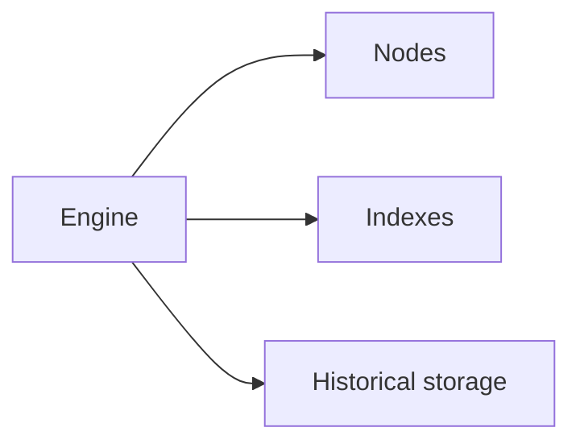

The engine reads each request's method and parameters, and sends it to the backend that can answer it fastest and most reliably:

* **[Nodes](/docs/documentation/architecture/nodes).** Most methods, including all writes, go to a node that's healthy and caught up with the blocks your request needs.
* **[Indexes](/docs/documentation/architecture/engine/indexes).** Wide queries, such as `eth_getLogs` over many blocks or the [Data](/docs/data) endpoints, are answered from indexes we build from the chain.
* **Historical storage.** Old blocks, transactions and traces come from storage built for history. See [Historical Data](/docs/what-is-archive-data-on-ethereum).

## Choosing a node

When a request goes to a node, the engine picks one that:

* **Has the blocks you need,** so your reads stay [consistent](/docs/documentation/architecture/engine/consistency/read-consistency).
* **Holds your earlier state,** such as a transaction you just sent or a filter you created. See [Sticky Routing](/docs/documentation/architecture/engine/consistency/sticky-routing).
* **Is healthy.** Nodes that lag or fail are taken out of rotation, and a request a node can't answer moves to another one. See [Fallbacks](/docs/documentation/architecture/engine/fallbacks).

Routing is automatic. You send standard JSON-RPC, and the engine does the rest.
