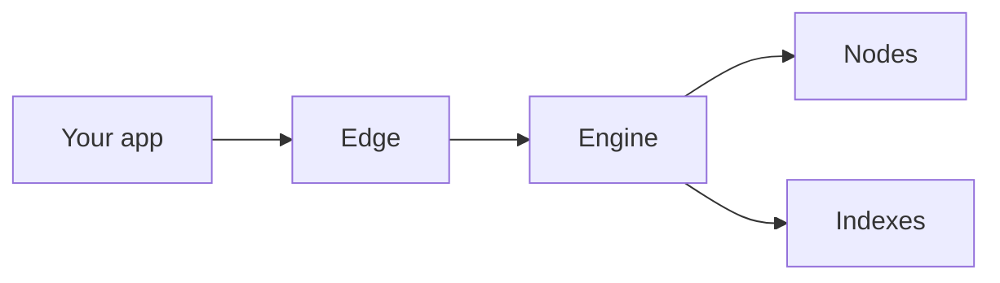

Every request passes through three layers: the edge receives it, the engine decides how to answer it, and nodes or indexes answer it. All three run in every [region](/docs/documentation/architecture/regions).

## The layers

1. **[Edge](/docs/documentation/architecture/edge).** Your request arrives at the closest region. The edge checks your [access token](/docs/how-to-create-access-keys), applies your [throughput](/docs/reference/throughput) limit and gives the request a [trace ID](/docs/documentation/monitoring/tracing).
2. **Engine.** The engine reads the method and its parameters and picks what should answer it. It keeps reads consistent across nodes, retries on another node when one fails, and keeps transactions and filters on the node that has them.
   * [Routing](/docs/documentation/architecture/engine/routing): how each request finds the right backend.
   * [Fallbacks](/docs/documentation/architecture/engine/fallbacks): what happens when a node or a region has a problem.
   * [Consistency](/docs/documentation/architecture/engine/consistency/read-consistency): why consecutive requests always agree.
   * [Indexes](/docs/documentation/architecture/engine/indexes): data the engine answers from directly, without a node.
3. **[Nodes](/docs/documentation/architecture/nodes).** Most methods, including all writes, are answered by nodes running several clients per network.

## What this means for your app

* **Consecutive reads can hit different nodes.** We keep them consistent, so the chain never appears to go backwards. See [Read Consistency](/docs/documentation/architecture/engine/consistency/read-consistency).
* **Writes stick to one node.** Transactions and filters are pinned so retries and follow-up calls find them. See [Sticky Routing](/docs/documentation/architecture/engine/consistency/sticky-routing).
* **Recent blocks can change.** Use `safe` or `finalized` when you need data that won't be reorged. See [Commitment Levels](/docs/documentation/architecture/engine/consistency/commitment-levels).
* **No change needed.** Routing is automatic. You send standard JSON-RPC and get standard responses.
